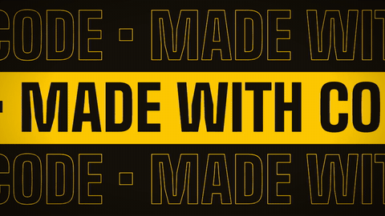
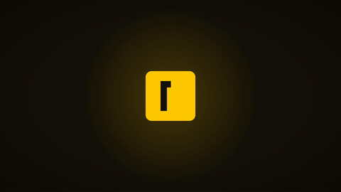
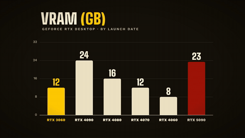
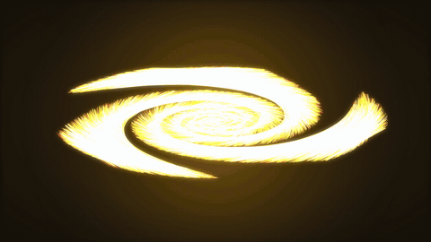
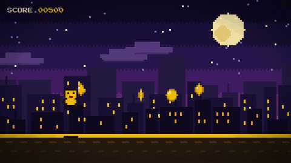
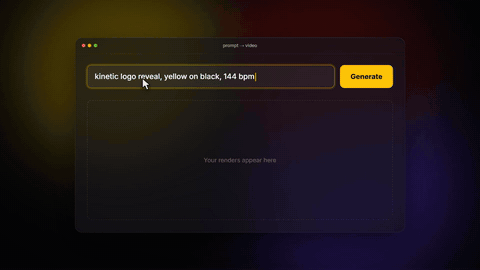
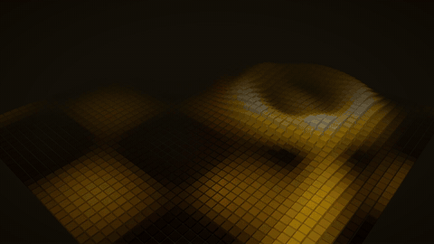
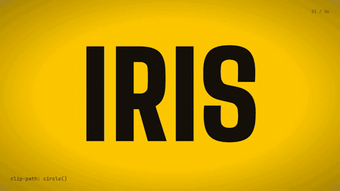

# AI Motion Graphics — made with code, not keyframes

Eight motion graphics and a beat-synced reel, all written as code with **[Remotion](https://www.remotion.dev)**
(video in React) and **[three.js](https://threejs.org)**, made by talking to a coding agent (Claude Code) in plain
language. No After Effects, no timeline, no keyframes. From the_frizzy1's video "Motion graphics made with AI" on YouTube.


**The reel:** [media/reel-720p-silent.mp4](media/reel-720p-silent.mp4) (no music in the repo — see *Sound* below)

| | | | |
|---|---|---|---|
|  |  |  |  |
|  |  |  |  |

| # | Piece | Technique |
|---|---|---|
| 01 | Kinetic type | every letter its own box on an easing curve, glitch slices on each cut |
| 02 | Logo reveal | SVG line drawing, circle mask, the mark built bar by bar on the beat |
| 03 | Data | bars + rolling counters, a live re-sort (real Nvidia VRAM numbers) |
| 04 | Particles | 9,000 dots on a canvas, galaxy → text, positions are pure functions of the frame |
| 05 | Pixel art | drawn at 160×90 and scaled up, parallax city, jumps timed to the beat |
| 06 | UI mockup | a glassy app as plain HTML/CSS, cursor + typing + progress |
| 07 | three.js 3D | 2,116 cubes, a shock ring every two beats |
| 08 | Transitions | iris, slice, split, blinds, pixels, push — each one a CSS trick |
| — | Reel | all of it cut together, every cut on a bar line |

Every piece also renders **9:16** (same code — the layout checks if the frame is tall).

---

## Step by step

### 1. What you need
- **Node.js** 18 or newer → <https://nodejs.org>
- **Git** (to download this repo) → <https://git-scm.com>
- Optional: **Python 3 + numpy**, only to make the sound effects yourself (`pip install numpy`)
- A GPU helps for the 3D piece (render with `--gl=angle`); everything else renders on any PC.

### 2. Get it running
```bash
git clone https://github.com/Thefrizzy1/AI-Motion-Graphics.git
cd AI-Motion-Graphics
npm install
npx remotion studio
```
The Studio opens in your browser: pick a piece on the left and press play.

### 3. Render a video
```bash
npx remotion render Reel out/reel.mp4 --gl=angle
npx remotion render 04-Particles out/particles.mp4
npx remotion render 01-KineticType-V out/kinetic-vertical.mp4
```

### 4. Or let your coding agent do all of it
You don't need to know any of the commands above. Open **Claude Code** (or Codex) in an empty folder and say:

> Install Remotion and three.js in this folder so I can make motion graphics with code. Set up a new Remotion project and tell me when it's ready.

Then describe what you want. All the prompts from the video are in **[PROMPTS.md](PROMPTS.md)**, in order.

**Tip:** install Remotion's official agent skill so your agent follows Remotion's best practices:
```bash
npx skills add remotion-dev/skills
```
(<https://github.com/remotion-dev/skills>)

---

## Sound
- **Sound effects** (`public/sfx/`): whoosh, pop, click, thud, ding, riser… are synthesised with maths in
  [`scripts/make_sfx.py`](scripts/make_sfx.py) — random noise, sine waves and envelopes, no samples, no licences.
  Remake them with `python scripts/make_sfx.py` (needs numpy).
- **Music:** not included (use a track you're allowed to use). Put it at `public/music/bed.mp3`, then measure it:
  ```bash
  python scripts/bpm.py public/music/bed.mp3
  ```
  It prints the tempo and the first beat — set `MUSIC_FIRST_BEAT` in [`src/kit.tsx`](src/kit.tsx). Everything here is
  timed on a 144 BPM grid (one beat = 12.5 frames at 30 fps). Without a music file the pieces render with the sound
  effects only.

## Change things
- Colours, fonts, easing and the beat grid: [`src/kit.tsx`](src/kit.tsx)
- Each piece is one file in [`src/`](src) — change the words, timing or colours there, or just ask your agent:
  *"make the second half slower and the text bigger"*.

---

## The benchmark from the video
Same prompt ([PROMPTS.md](PROMPTS.md#benchmark-prompt)) to three AIs, each in its own agent, on my PC:

| Model | Agent | Prompt → finished MP4 |
|---|---|---|
| GPT-6 Luna | Codex CLI | 6 min 47 s |
| Claude Opus 5.5 | Claude Code | 11 min 26 s |
| Flint (Q2_K_XL, local on an RTX 3060 12 GB) | Codex CLI + llama.cpp | ~1 h 04 min to write the code, could not render it itself; I fixed 2 bugs by hand |

One run each, so take the times as an example, not a ranking.

---

Remotion has its own license — check <https://www.remotion.dev/license> before using it commercially.
Fonts: Big Shoulders, Work Sans, Inter, JetBrains Mono, Press Start 2P, Instrument Serif (Google Fonts, loaded by Remotion).
